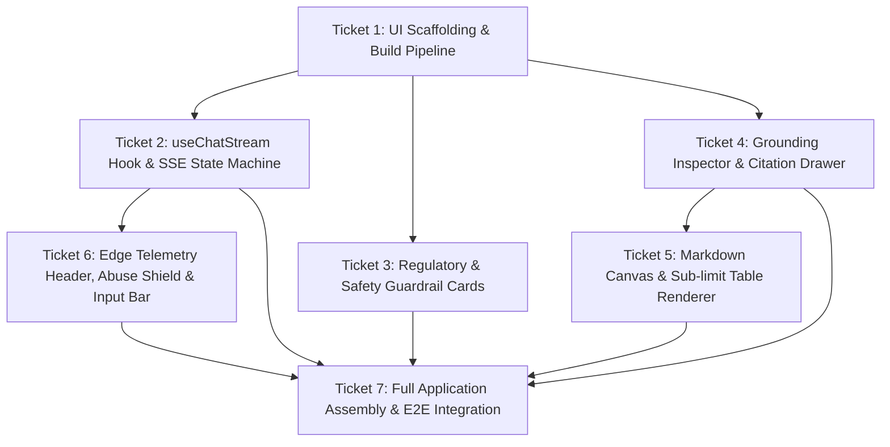

# Wayfinding Map: Frontend Chat Interface (Spec 05)

**Spec Reference:** [`spec.md`](spec.md)  
**Integration Branch:** `feat/spec-05-pages-frontend`

## Notes & Decisions
- React 19 UI with Tailwind CSS and Lucide icons running on Cloudflare Pages.
- Client SSE state machine, grounding inspector, regulatory disclaimer cards, citation drawer.

## Task Graph

## Decisions So Far
- All tickets 01–07 completed and verified against Cloudflare Pages edge build.
