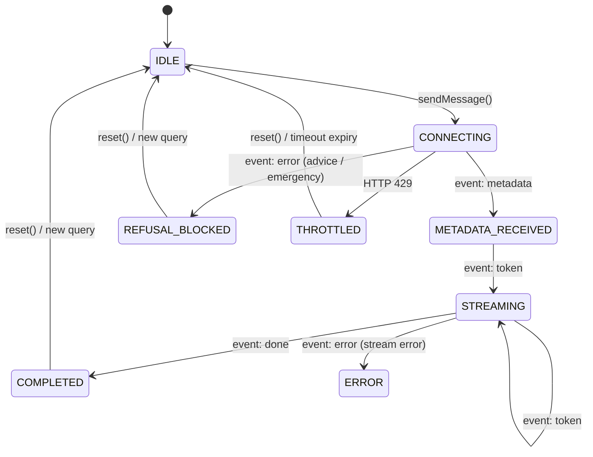

# Specification: Phase 6 — Cloudflare Pages Frontend Chat Interface

**Module:** `src/frontend/` (Cloudflare Pages SPA)  
**Status:** Living Specification  
**Version:** 2.0.0  
**Associated Specs:** [Spec 02 (Edge Runtime)](02-edge-rag-runtime.md), [Spec 03 (Regulatory Compliance)](03-regulatory-compliance.md), [Spec 04 (AFCA Evals)](04-afca-eval-benchmarks.md), [Spec 06 (Corpus Refinement)](06-corpus-refinement-and-compilation.md)  
**Associated ADRs:** [ADR-0001 (AI Search)](../adr/0001-cloudflare-ai-search-hybrid-retrieval.md), [ADR-0002 (Pre-Normalized R2)](../adr/0002-pre-normalized-markdown-r2-ingestion.md), [ADR-0003 (Static AST Corpus)](../adr/0003-static-ast-corpus-edge-fallback.md), [ADR-0004 (Canonical Insurers)](../adr/0004-canonical-insurer-registry-alias-resolution.md)  
**Test Contracts:** [`tests/frontend/`](../../tests/frontend/) (11 suites, 84 tests)

---

## 1. Problem Statement

Australian retail insurance consumers and brokers navigating dense Product Disclosure Statements (PDS) face impenetrable legal text (80–140 pages), scattered sub-limit schedules, and fragmented disclosures across 39 competing insurers.

While the Edge Worker (`POST /api/chat`) provides grounded streaming answers with strict ASIC RG 244 advice boundaries, users require a responsive, accessible interface that:
1. Streams responses token-by-token with sub-350ms Time-to-First-Token (TTFT).
2. Provides clickable, transparent citations linking directly to operative PDS clauses and sub-limits tables.
3. Allows querying and comparing policies across all **39 primary insurers** and **24 bancassurance aliases**.
4. Clearly enforces non-negotiable regulatory boundaries: persistent Section 949A GAW warnings, ASIC safe-harbor advice refusals, and urgent red emergency hotlines (000, 132 500, 1800 018 444).
5. Assures user privacy via client-side PII scrubbing before network transmission under APPs 3 & 11.

---

## 2. Technical Architecture & Component Hierarchy

The frontend is an unauthenticated Single Page Application (SPA) built with **React 19**, **TypeScript**, **Vite**, and **Tailwind CSS**, deployable to Cloudflare Pages (`wrangler pages deploy dist`).

```
src/frontend/
├── App.tsx                     # Top-level state orchestration & view switching
├── main.tsx                    # React 19 root mount
├── hooks/
│   └── useChatStream.ts        # Core testing seam: SSE client & streaming state machine
├── types/
│   └── chat-ui.ts              # UI models, StreamState, and Telemetry contracts
├── utils/
│   ├── citations.ts            # Citation parsing & chunk matching heuristics
│   └── client-pii-scrubber.ts  # Browser pre-ingress APP 3/11 PII redaction
└── components/
    ├── AppShell.tsx            # Navigation bar, telemetry meters, comparison toggle & GAW footer
    ├── ChatContainer.tsx       # Message list, auto-scrolling, stream anchoring & starter prompts
    ├── UserMessage.tsx         # User query bubble with insurer filter pill
    ├── AssistantMessage.tsx    # Streaming Markdown canvas, tabular sub-limits, inline citations
    ├── InputBar.tsx            # Query textarea, 39-insurer selector, Turnstile container
    ├── CitationPill.tsx        # Clickable inline badge [Source: Insurer Product (Section)]
    ├── CitationDrawer.tsx      # Slide-over sheet with breadcrumbs, underwriter & raw Markdown
    ├── PolicyComparisonView.tsx# Side-by-side comparison matrix across 39 insurers
    ├── RefusalCard.tsx         # ASIC RG 244 safe-harbor refusal explanation card
    ├── EmergencyBanner.tsx     # High-contrast red COP emergency banner with one-touch dial
    ├── RateLimitBadge.tsx      # Remaining request counter derived from X-RateLimit-*
    ├── PiiAssuranceBadge.tsx   # Pre-ingress PII protection indicator
    └── StatutoryGaw.tsx        # Canonical Corporations Act Section 949A disclaimer
```

---

## 3. Core Testing Seam: `useChatStream` State Machine

The single testing seam for all streaming and regulatory interactions is the `useChatStream` hook ([`src/frontend/hooks/useChatStream.ts`](../../src/frontend/hooks/useChatStream.ts)).

### 3.1 State Transitions



### 3.2 Protocol Robustness Invariants
1. **Fragmented Packet Reassembly:** Assembles incoming SSE packets across arbitrary chunk boundaries using a persistent buffer.
2. **Safe JSON Parsing:** Defensively parses `data:` payloads and gracefully handles unescaped token strings.
3. **Session Storage Persistence:** Persists messages in browser `sessionStorage` (with defensive fallback if restricted).
4. **Rate Limit Tracking:** Derives `limit`, `remaining`, and `resetSeconds` directly from `X-RateLimit-*` response headers.

---

## 4. Key UI Capabilities

### 4.1 Chat Layout and 39-Insurer Grouped Dropdown (`InputBar.tsx`)
* The viewport uses a fixed-height flex column: a non-shrinking header and footer surround a `min-h-0` main region, with an independently scrolling conversation and non-shrinking bottom composer.
* Consumer copy omits infrastructure telemetry and model labels. The grouped insurer selector is an icon control inside the floating composer; its current selection is named for assistive technology and available as a title.
* Empty conversations start at the top of the mobile chat region so the heading and starter questions appear immediately; starter questions wrap without truncation. The composer is followed by centered inline legal and privacy controls.
* Uses `getGroupedInsurerOptions()` ([`src/constants/insurers.ts`](../../src/constants/insurers.ts)) to render categorized `<optgroup>` options:
  * **All Insurers (General Corpus)**
  * **Suncorp Group (6):** Suncorp, AAMI, GIO, APIA, Shannons, Bingle
  * **Major Insurers (4):** Allianz, QBE, Vero, NRMA
  * **Challengers & Auto Clubs (9):** Budget Direct, RAC WA, RAA, RACT, RACV, RACQ, CGU, Youi, TIO
  * **Travel Specialists (8):** Go Insurance, 1Cover, InsureandGo, Fast Cover, Southern Cross Travel Insurance, Zoom, Cover-More, Travel Insurance Direct
  * **Life Insurers (12):** Zurich, AIA, NobleOak, NEOS, HCF Life, Acenda, Challenger, ClearView, MetLife, TAL, PPS Mutual, Asteron Life
* Automatically resolves bancassurance queries (e.g. "CommBank") to their issuing underwriter ("Allianz").

### 4.2 Interactive Citation Drawer (`CitationDrawer.tsx` & `CitationPill.tsx`)
* The source shelf is a compact vertical list headed "Sources", with borderless document title controls and single-line, plain-text snippet previews. Markdown formatting is stripped only from previews; selecting a title opens the original source in the citation drawer. No match scores, insurer badges, counters, or horizontal carousel appear in the list.
* Inline citations are small bracketed references with accessible source details and open the citation drawer. Citation-only paragraphs and list entries keep a readable document title instead of an isolated marker; this presentation is identical across viewport sizes. Empty Markdown list markers are omitted. Descriptive links replace raw HTTP(S) URLs in answer prose, and related questions appear as muted text controls.
* Detects citation patterns formatted as `[Source: {insurer} {product} ({section})]` or `[Insurer Product, Section X]`.
* Maps citation strings to retrieved chunks via `findMatchingChunk()` using a 4-tier match strategy:
  1. Direct chunk ID match
  2. Combined Product and Section match
  3. Section match
  4. Product name match
* Slide-over drawer displays:
  * Insurer brand & statutory underwriter (e.g. `AAI Limited (ABN 48 005 297 807, AFSL 230859)`)
  * Document classification (`PDS`, `SPDS`, `TMD`, `FAQ`, `GUIDE`) and effective date
  * Retrieval relevance score badge (e.g. `94% match`)
  * Full operative section excerpt rendered as formatted Markdown with tables

### 4.3 39-Insurer Policy Comparison (`PolicyComparisonView.tsx`)
* Allows users to select two insurers from all 39 primary brands and compare policy terms across standard dimensions (`POLICY_COMPARISON_DIMENSIONS`):
  * Building & Contents Coverage
  * Accidental Damage
  * Flood & Water Damage
  * 72-Hour Embargo
  * Jewelry & Watch Sub-Limits
  * Standard Basic Excess
  * Towing & Emergency Assistance
* Displays category baseline conditions with insurer-specific schedule overrides via `resolvePolicyComparisonCell()`.
* Renders each coverage category as a standalone heading followed by the primary insurer’s terms and then the comparison insurer’s terms in a vertical definition list. There is no horizontal comparison table or outer card.
* The screen uses the title "Compare Policies", direct insurer selectors, and a plain Back control at the top left. Policy sources from the current chat remain accessible below the comparisons.

### 4.4 Regulatory & Life-Safety Cards
* **ASIC RG 244 Safe-Harbor Card (`RefusalCard.tsx`):** Triggered when `ADVICE_BOUNDARY_VIOLATION` is received; renders safe-harbor advice refusal, explains the statutory boundary, and presents factual inquiry suggestions.
* **COP Emergency Banner (`EmergencyBanner.tsx`):** Triggered when `EMERGENCY_INTERCEPTION` is received; renders high-contrast red banner with one-tap `tel:000`, `tel:132500`, and `tel:1800018444` buttons.
* **Statutory GAW Footer & Multi-Layer Deduplication (`StatutoryGaw.tsx`, `src/constants/statutory.ts`, `AssistantMessage.tsx`, `RefusalCard.tsx`, `AppShell.tsx`):**
  * Persistent, non-dismissible Section 949A disclaimer rendered via `<StatutoryGaw />`.
  * `stripStatutoryGaw()` and `isGawDisclaimerText()` in `src/constants/statutory.ts` strip raw LLM-emitted GAW boilerplate (exact copy, headings, bold/italic, blockquotes, bullets, numbered items, quotes, and partial streaming tails) from `AssistantMessage`, `RefusalCard`, and `useChatStream` multi-turn history, while preserving educational explanations of Section 949A.
  * `AppShell` owns one persistent canonical warning in `<ComplianceFooter />` across chat, streaming, refusal, and comparison views. `ChatContainer` disables inline warning cards; the footer expands in normal flow inside a bounded scroll area so legal and privacy details cannot overlap the composer.
* **Known Policy Exclusion vs. Silent PDS Notice Demarcation (`AssistantMessage.tsx`):**
  * Standard insurance specialist answers routinely state what is excluded (*"Storm surge and actions of the sea are not covered"* or *"The policy does not cover damage during the first 72 hours"*). These are **known contractual exclusions**, not missing policy data.
  * `SILENT_PDS_REGEX` in [`src/frontend/components/AssistantMessage.tsx`](../../src/frontend/components/AssistantMessage.tsx) must strictly match genuine **Policy Silence / Unlisted Hazard** admissions (`does not specify`, `silent on`, `policy is silent`, `pds is silent`, `unlisted domestic hazard`, `not named in the insured events`, e.g., AFCA TC-10 `pet chimpanzee`) and must **never** match ordinary exclusion statements (`not covered`, `does not cover`, `is excluded`).

---

## 5. Verification & Test Contracts

The frontend test suite (`tests/frontend/`) executes 11 test suites covering 84 discrete assertions:

| Test Suite | File | Core Assertions |
| :--- | :--- | :--- |
| **Hook Lifecycle** | `useChatStream.test.tsx` | State transitions (`CONNECTING → METADATA → STREAMING → COMPLETED`), refusal handling, 429 throttling, packet reassembly. |
| **App Integration** | `app-integration.test.tsx` | End-to-end rendering from starter prompt to streaming tokens, drawer opening, comparison view toggling. |
| **Citation System** | `citation-drawer.test.tsx`, `citations-utils.test.ts` | Citation pill rendering, chunk matching heuristics, drawer slide-over and close interactions. |
| **Regulatory Cards** | `regulatory-cards.test.tsx` | Refusal card rendering, emergency banner dial buttons, persistent GAW disclaimer. |
| **Policy Comparison** | `policy-comparison.test.tsx` | 39-insurer selector updates, benchmark table rows, session disclosure overlay, quick launch prompts. |
| **Header & Input** | `header-input.test.tsx` | Insurer selector options, rate-limit pills, textarea auto-resize, submit button disabling. |
| **PII Scrubber** | `client-pii-scrubber.test.ts` | Pre-ingress scrubbing of TFNs, Medicare, Credit Cards, Phones, and Licences. |

---

## 6. Known Gaps

| # | Gap | Current Behaviour | Target Behaviour |
| :--- | :--- | :--- | :--- |
| G6 | User Feedback Submission | Feedback score column exists in D1 schema; UI does not have thumbs up/down buttons. | Add feedback buttons on `AssistantMessage` that dispatch to `POST /api/feedback`. |


### Responsive navigation and composer

At 1024px and wider, a persistent sidebar lists the current session's user questions and navigation. On smaller screens, navigation opens in a modal drawer with trapped focus, Escape and backdrop dismissal, and focus restoration; a standalone new-chat action remains in the mobile header. The desktop sidebar is the only global navigation surface, with New Chat first, and collapses from 256px to a 64px icon rail. Its top-left header toggle preserves an 800px maximum chat width centered in the remaining space; selecting History expands the sidebar. Selecting a question returns to chat and scrolls to that message, including repeated selections. Switching to comparison and back preserves the unsent draft. Enter submits a question, Shift+Enter inserts a newline, and Enter during IME composition does not submit. The send control sits inside the textarea row, the insurer selector is embedded in the floating pill, and the keyboard hint is available to assistive technology. Mobile header icons use borderless 44px hit areas, starter questions begin at the top of the chat region, the composer is followed by an inline disclosure footer, and the shell follows visual viewport height during keyboard resizing while ignoring pinch zoom.

Chat messages use an unframed assistant response and a right-aligned soft-blue user bubble. Tables retain horizontal scrolling and semantic headers without an outer card. The centered footer has plain General advice warning and Privacy controls, with disclosures expanding in normal flow.

History lists the current conversation's questions, not archived sessions. Deleting a question removes its associated answer; the desktop row exposes a contextual delete control, while mobile rows reveal Delete on a left swipe and support the Delete key. Clear all history and Undo deletion appear at the bottom of the expanded history panel. Deletions update session storage and subsequent conversation context; deleting an active turn or clearing history cancels its stream.

### Feed scrolling and layout invariants

Automatic streaming updates, explicit bottom jumps, and history navigation scroll only the message feed, never ancestor layout containers. Automatic following is immediate so intermediate smooth-scroll events cannot disable anchoring. Manual reading position is preserved; feed resizing rechecks the bottom distance. The bottom-jump control occupies a reserved row above the composer and never overlays response text.
