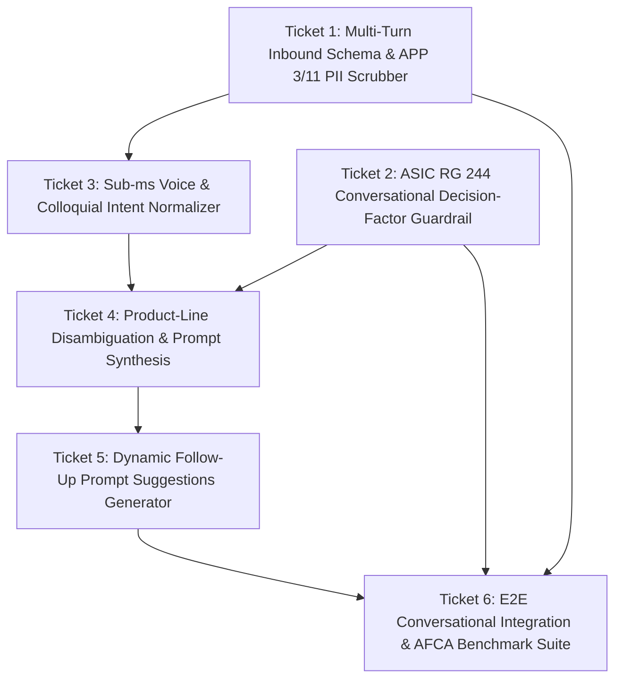

# Wayfinding Map: Conversational Natural Language Inquiries (Spec 07)

**Spec Reference:** [`spec.md`](spec.md)  
**Triage Role:** `ready-for-agent`  
**Integration Branch:** `feat/spec-07-conversational-rag`

## Notes & Decisions
- Multi-turn inbound schema with APP 3/11 PII scrubbing.
- ASIC RG 244 conversational decision-factor guardrail.
- Sub-ms voice & colloquial intent normalizer mapping slang/speech-to-text tokens to statutory insurance terms.
- Product-line disambiguation and dynamic follow-up prompt chips.
- Comprehensive AFCA benchmark suite for conversational multi-turn flows.

## Task Graph

## Decisions So Far
- Architecture and living spec authored at `spec.md`.
- All 6 tickets triaged and marked `ready-for-agent`.
- **Ticket 01 Resolved:** Extended `ChatRequestSchema` with `history` (max 4, max 1000 chars/message) and upgraded `sanitizePii()` for multi-turn history scrubbing while hashing only the latest query for k-anonymity ([`01-multi-turn-inbound-schema-pii-scrubber.md`](issues/01-multi-turn-inbound-schema-pii-scrubber.md)).
- **Ticket 02 Resolved:** Updated `evaluateAdviceBoundary()` to detect conversational dilemmas (`CONVERSATIONAL_DILEMMA`) for objective decision-factor education while maintaining deterministic `STATUTORY_SAFE_HARBOR_REFUSAL` on personal switching/budget prompts ([`02-asic-rg244-conversational-decision-factor-guardrail.md`](issues/02-asic-rg244-conversational-decision-factor-guardrail.md)).
- **Ticket 03 Resolved:** Implemented sub-ms deterministic voice & colloquial intent normalizer `src/rag/intent-normalizer.ts` and integrated intent peril boosts into `localHybridSearch` ([`03-sub-ms-voice-colloquial-intent-normalizer.md`](issues/03-sub-ms-voice-colloquial-intent-normalizer.md)).
