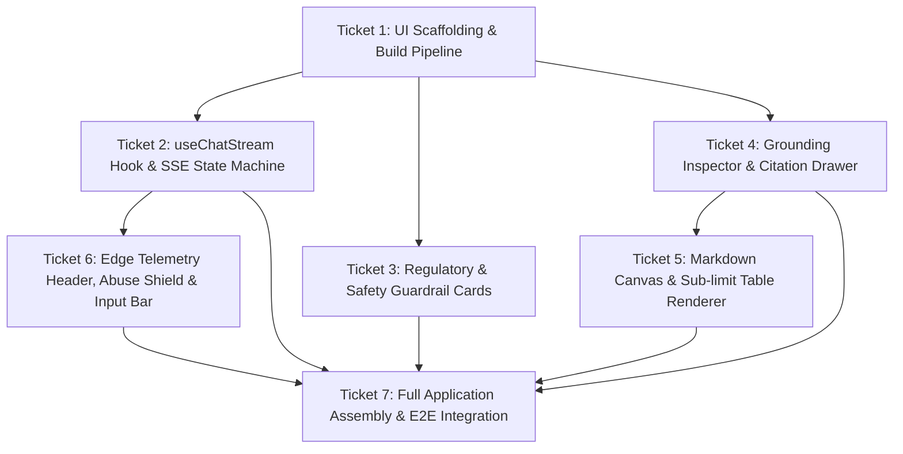

# Task Graph: Spec 05 — Cloudflare Pages Frontend Chat Interface

**Spec Reference:** [`docs/specs/05-frontend-chat-interface.md`](../specs/05-frontend-chat-interface.md)  
**Integration Branch:** `feat/spec-05-pages-frontend`

## Tickets

### Ticket 1: UI Scaffolding & Build Pipeline
- **Status:** COMPLETED
- **Dependencies:** None

### Ticket 2: useChatStream Hook & SSE State Machine
- **Status:** COMPLETED
- **Dependencies:** Ticket 1

### Ticket 3: Regulatory & Safety Guardrail Cards
- **Status:** COMPLETED
- **Dependencies:** Ticket 1

### Ticket 4: Grounding Inspector & Citation Drawer
- **Status:** COMPLETED
- **Dependencies:** Ticket 1

### Ticket 5: Markdown Canvas & Sub-limit Table Renderer
- **Status:** COMPLETED
- **Dependencies:** Ticket 1, Ticket 4

### Ticket 6: Edge Telemetry Header, Abuse Shield & Input Bar
- **Status:** COMPLETED
- **Dependencies:** Ticket 2

### Ticket 7: Full Application Assembly & E2E Integration
- **Status:** COMPLETED
- **Dependencies:** Tickets 2, 3, 4, 5, 6
