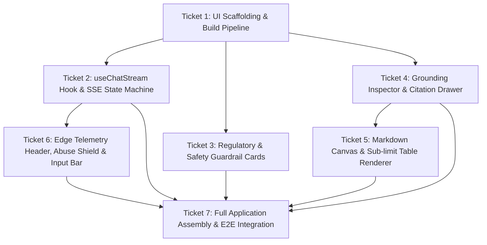

# Task Graph: Spec 05 — Cloudflare Pages Frontend Chat Interface

**Spec Reference:** [`docs/specs/05-frontend-chat-interface.md`](../specs/05-frontend-chat-interface.md)  
**Integration Branch:** `feat/spec-05-pages-frontend`

## Tickets

### Ticket 1: UI Scaffolding & Build Pipeline
- **Status:** READY (Frontier)
- **Dependencies:** None
- **Description:** 
  - Install and configure React 19, Vite, Tailwind CSS, Lucide React, and testing utilities (happy-dom, testing-library).
  - Setup `index.html`, `vite.config.ts`, `tailwind.config.ts`, `postcss.config.js`.
  - Ensure static asset build outputs to `dist/` deployable to Cloudflare Pages.
  - Update `package.json` scripts: `build`, `build:pages`, `test:frontend` and integrate into `npm run verify`.
  - Ensure existing edge worker tests and afca evals continue passing.

### Ticket 2: useChatStream Hook & SSE State Machine
- **Status:** BLOCKED by Ticket 1
- **Dependencies:** Ticket 1
- **Description:**
  - Implement custom hook `useChatStream` concealing SSE parsing and state machine.
  - States: `IDLE`, `CONNECTING`, `METADATA_RECEIVED`, `STREAMING`, `COMPLETED`, `REFUSAL_BLOCKED`, `THROTTLED`.
  - Handle `event: metadata` (latencies, chunks), `event: token` (token accumulation), `event: done` (total tokens, finish reason), `event: error` (ASIC advice refusal or emergency payload).
  - Parse `X-RateLimit-Limit`, `X-RateLimit-Remaining`, `X-RateLimit-Reset` response headers.
  - Manage TTFT timing and Anycast PoP data.
  - Seam: `fetch` returning `text/event-stream`.
  - TDD tests with synthetic SSE streams.

### Ticket 3: Regulatory & Safety Guardrail Cards
- **Status:** BLOCKED by Ticket 1
- **Dependencies:** Ticket 1
- **Description:**
  - `RefusalCard`: ASIC RG 244 safe-harbor refusal card displaying deterministic advice refusal, explanation, and recommendation to seek licensed financial adviser.
  - `EmergencyBanner`: High-contrast emergency banner for active peril interception with one-touch `tel:000`, `tel:132500`, and `tel:1800018444` buttons.
  - `StatutoryGaw`: Persistent Section 949A GAW warning using canonical `STATUTORY_GAW` text.
  - TDD tests verifying rendering and accessibility of warning/emergency components.

### Ticket 4: Grounding Inspector & Citation Drawer
- **Status:** BLOCKED by Ticket 1
- **Dependencies:** Ticket 1
- **Description:**
  - `CitationDrawer`: Slide-over drawer presenting retrieved chunks, relevance score badges, operative PDS section breadcrumbs, and raw source text.
  - Inline citation pill parser/click handler connecting cited passages (`[Source: Suncorp Classic Home PDS, Section 1]`) to drawer items.
  - TDD tests for drawer open/close, chunk inspection, and citation pill interaction.

### Ticket 5: Markdown Canvas & Sub-limit Table Renderer
- **Status:** BLOCKED by Ticket 1, Ticket 4
- **Dependencies:** Ticket 1, Ticket 4
- **Description:**
  - `AssistantMessage`: Streamed markdown renderer supporting bold, lists, callout banners, and clean tabular formatting for policy sub-limits (jewelry, excess tiers).
  - Inline citation pill rendering linking directly to `CitationDrawer`.
  - Negative constraint styling for ungrounded/silent PDS perils.
  - Copy answer button with clipboard feedback.
  - `UserMessage`: User query card with insurer badge.
  - TDD tests for markdown parsing, table rendering, and copy button.

### Ticket 6: Edge Telemetry Header, Abuse Shield & Input Bar
- **Status:** BLOCKED by Ticket 2
- **Dependencies:** Ticket 2
- **Description:**
  - `AppShell` header with Cloudflare Anycast PoP indicator (`SYD`, `MEL`, `LOCAL`), TTFT badge, and retrieval latency indicator.
  - `RateLimitBadge`: Live pill showing remaining queries in 10 req/min window with reset timer countdown.
  - `PiiAssuranceBadge`: Client-side badge assuring Australian Privacy Principles (TFN, Medicare redaction).
  - `InputBar`: Auto-resizing textarea, Enter to submit, insurer filter dropdown (Allianz, Suncorp, NRMA, QBE, Youi, All), Turnstile token integration, and disabled states when throttled or streaming.
  - TDD tests for input submission, rate-limit badge states, insurer selection.

### Ticket 7: Full Application Assembly & E2E Integration
- **Status:** BLOCKED by Tickets 2, 3, 4, 5, 6
- **Dependencies:** Tickets 2, 3, 4, 5, 6
- **Description:**
  - Assemble `App` connecting `useChatStream`, `AppShell`, `ChatContainer`, `InputBar`, `CitationDrawer`, `EmergencyBanner`, `RefusalCard`.
  - `sessionStorage` chat history persistence.
  - Mobile responsiveness down to 360px viewport.
  - Comprehensive integration test suite covering end-to-end user workflows: asking a question, streaming response, opening citation drawer, handling advice refusal, emergency trigger, and rate limiting.
  - Verify complete gate: `npm run verify` passes with 100% of tests.
